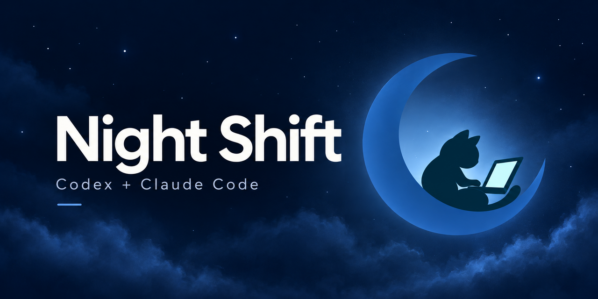
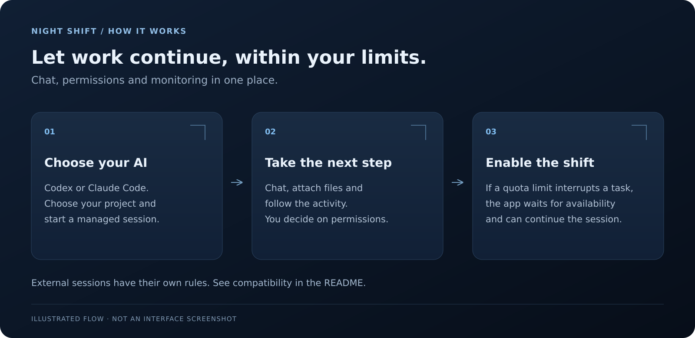
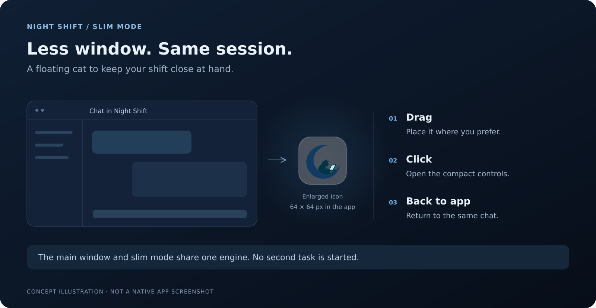

# Night Shift

**You hit the limit. Your work does not have to end there.**

Night Shift is a Windows app that **automatically continues tasks interrupted by Codex and Claude Code usage limits**. It monitors the interruption, waits for availability to return, and continues the task while your shift is active — so you do not have to come back just to ask the AI to continue.

Automatic continuation works in **supported managed sessions**, started or resumed through Night Shift. Keep the app open and your PC on and connected. External sessions have their own rules, explained below.

**Version 0.7.1 · Windows 10/11 x64 · WPF · .NET 10**

[Install (PT-BR)](docs/INSTALL.md) · [Full guide (PT-BR)](docs/USER-GUIDE.pt-BR.md) · [Compatibility (PT-BR)](docs/COMPATIBILITY.md) · [Português](README.md)

## Limit → wait → continue

1. **A limit interrupts your task.** With the shift enabled, Night Shift identifies the interruption caused by a usage limit.
2. **The app waits.** It monitors provider availability during your configured shift period.
3. **Work continues.** Once availability returns, it automatically requests continuation in the supported managed session.



*Explanatory illustration, not a screenshot of the Windows interface.*

Night Shift **respects provider limits**: continuation depends on availability. Completed tasks, errors, questions and refusals are handled separately; permissions still require your decision. Stopping or closing the app cancels pending continuation.

“Keep computer awake” prevents sleep while monitoring; it cannot wake an already sleeping PC.

## Get started

1. Open **Releases** on the repository page and find `Night-Shift-v0.7.1-Windows-x64.zip`, if published.
2. Extract the entire ZIP into a stable folder and run `NightShift.exe`.
3. Install and authenticate the chosen provider's CLI: Codex CLI or local Claude Code.
4. Choose the provider, connect and select your project folder.
5. Enable the shift, set its duration and send your task in the managed session. If a usage limit interrupts work during that period, Night Shift can continue it automatically once availability returns.

The package includes the .NET runtime; the SDK is needed only for development. Claude Code requires native version **2.1.234 or later**.

Read [installation and updates](docs/INSTALL.md) before replacing an existing installation.

## Tools to support your shift

These features help you set up your task and keep an eye on the shift:

- **Slim mode:** a floating cat gives you compact controls for the same session.
- **Built-in chat:** send your task and monitor history, activity, limits and permission requests.
- **Codex and Claude Code:** choose your provider at the top, with separate preferences, drafts, attachments and caches.
- **Provider themes:** blue for Codex, warm tones for Claude, with independent light/dark modes.

You can switch providers only while the shift is inactive. Switching provider, platform or theme does not send a task.

## One session, two ways to monitor



*Explanatory slim mode illustration, not a native screenshot of the app.*

The main window and slim mode use the same engine and session. The compact panel lets you choose provider/platform when available, connect, refresh sessions, attach a session and monitor status and duration.

**Back to app** reopens the main window. Slim mode does not start a second task.

## Where automatic continuation works

Automatic continuation is the app’s focus, but support depends on the session type:

| Session type | Monitoring | Continuation after a quota limit |
| --- | --- | --- |
| Managed Codex CLI | Chat, history, permissions and limits | Automatic after checking availability |
| Managed Claude Code | Structured protocol and supported capabilities | Automatic only for a task interrupted by a quota limit |
| Shared Codex | Local backend accessible to both Night Shift and the client | Revalidation and an explicit **Continue task** click |
| External Claude Code | Observation of status and pending requests | Handled in the original client; no automatic control |

**Codex CLI:** must be installed and authenticated. Managed mode uses the official protocol; Codex retains its credentials and policies.

**Codex Desktop / VS Code:** experimental connectors for an already accessible shared local app-server. Selecting a platform does not detect the client or grant access to private backends. The Windows socket path remains unvalidated.

**Claude Code:** local sessions managed through the structured protocol. There is no automatic control of Claude Desktop, regular chat or Cowork.

**External Claude:** discovery depends on commands supported by the installed CLI. For supported background sessions, **Attach** opens the native terminal with `claude attach <id>`. Interactive sessions may require a response in their original terminal. The app does not write to live transcripts or start concurrent copies. Resuming that history as a managed session requires the previous process to end and explicit confirmation.

See versions, mechanisms and restrictions in [COMPATIBILITY.md (PT-BR)](docs/COMPATIBILITY.md).

## Chat and data

Attach using **+**, Ctrl+V or drag and drop: up to **10 files of 25 MB per message**. Valid PNG/JPEG images may be sent as native attachments; other files are referenced by local path, subject to the agent's tools and permissions. Originals are not modified.

The agent retains the canonical history. Clearing the local cache does not delete it. Missing quota information is shown as **Not reported**, without estimates derived from chat text.

Supported permission requests and questions appear in the interface. They are not approved automatically. Night Shift does not bypass provider permissions, sandboxing or policies.

| Shortcut | Action |
| --- | --- |
| Ctrl+Enter | Send message |
| Ctrl+K | Open Actions |
| F1 | Open commands |
| Esc | Close the limits panel or interrupt work |

For large histories, provider commands, unconfirmed sends and draft recovery, see the [full guide (PT-BR)](docs/USER-GUIDE.pt-BR.md).

## Validation status

All **142/142 logic tests passed again on October 14, 2026**, while preparing this repository, using simulated subprocesses and servers. The original **0.7.1** delivery compiled the Windows test project and published the executable; this preparation preserves that same executable.

**The WPF interface and native tests were not executed on Windows.** This round did not include authenticated login, a real Claude conversation, actual quota exhaustion or end-to-end Desktop/VS Code validation. Compiling WPF tests is not equivalent to running them.

See [VALIDATION.md (PT-BR)](docs/VALIDATION.md) for evidence, limitations and reproduction steps.

## Develop and contribute

On Windows with the .NET 10 SDK and PowerShell, run from the project root:

```powershell
./scripts/Build.ps1
```

The script runs logic tests, publishes for Windows x64 and creates a ZIP in a unique `artifacts` folder. To also run the WPF suite:

```powershell
./scripts/Build.ps1 -ValidateUI
```

- [Contributing (PT-BR)](CONTRIBUTING.md)
- [Provider contract (PT-BR)](docs/CONTRIBUTING-AGENTS.md)
- [Version history (PT-BR)](CHANGELOG.md)
- [Security and responsible reporting (PT-BR)](SECURITY.md)

## License

Code is under the [MIT license](LICENSE). Third-party notices are in [docs/licenses](docs/licenses). Integrations use the providers' local installations and do not alter their terms or policies.
