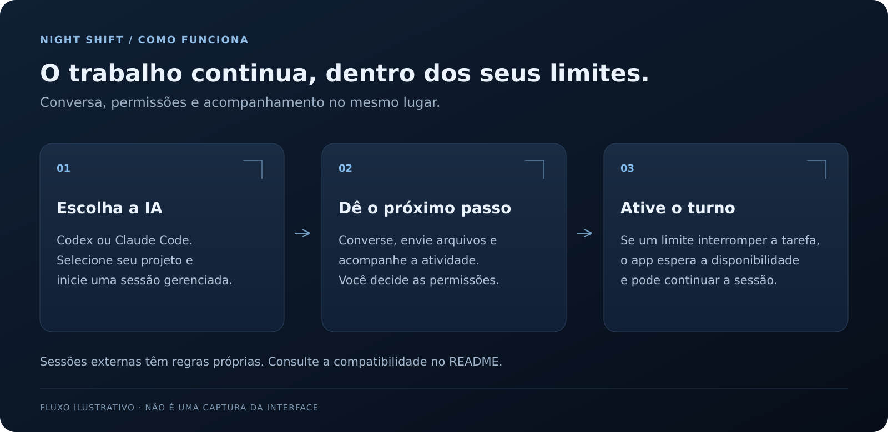
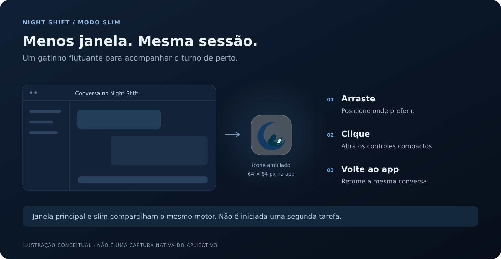

# Night Shift

**O limite chegou. Seu trabalho não precisa terminar.**

Night Shift é um aplicativo Windows que **retoma automaticamente tarefas interrompidas por limites de uso do Codex e Claude Code**. Ele acompanha a interrupção, espera a disponibilidade voltar e continua a tarefa enquanto o turno estiver ativo — sem você precisar voltar apenas para pedir que a IA continue.

A retomada automática funciona em **sessões gerenciadas compatíveis**, iniciadas ou retomadas pelo Night Shift. Mantenha o aplicativo aberto e o computador ligado e conectado. Sessões externas têm regras próprias, descritas abaixo.

**Versão 0.7.1 · Windows 10/11 x64 · WPF · .NET 10**

[Instalar](docs/INSTALL.md) · [Manual completo](docs/USER-GUIDE.pt-BR.md) · [Compatibilidade](docs/COMPATIBILITY.md) · [English](README.en.md)

## Limite → espera → retomada

1. **O limite interrompe a tarefa.** Com o turno ativado, o Night Shift identifica a interrupção por limite de uso.
2. **O aplicativo espera.** Acompanha a disponibilidade do provedor durante o período configurado para o turno.
3. **A tarefa continua.** Quando houver disponibilidade, solicita a continuação automaticamente na sessão gerenciada compatível.



*Ilustração explicativa; não é uma captura da interface no Windows.*

O Night Shift **respeita os limites do provedor**: a retomada depende de haver disponibilidade. Tarefas concluídas, erros, perguntas e recusas são tratados separadamente; permissões continuam dependendo de você. Parar ou fechar o aplicativo cancela a continuação pendente.

“Manter o computador acordado” impede suspensão durante o acompanhamento; não acorda um computador já suspenso.

## Comece em poucos passos

1. Abra **Releases** na página do repositório e procure o pacote `Night-Shift-v0.7.1-Windows-x64.zip`, se publicado.
2. Extraia o ZIP completo para uma pasta estável e execute `NightShift.exe`.
3. Instale e autentique a CLI do provedor escolhido: Codex CLI ou Claude Code local.
4. Escolha o provedor, conecte e selecione a pasta do projeto.
5. Ative o turno, configure sua duração e envie a tarefa na sessão gerenciada. Se um limite interromper o trabalho durante esse período, o Night Shift poderá retomá-lo automaticamente quando houver disponibilidade.

O runtime .NET acompanha o pacote; o SDK só é necessário para desenvolvimento. Claude Code exige versão nativa **2.1.234 ou superior**.

Leia [instalação e atualização](docs/INSTALL.md) antes de substituir uma instalação existente.

## Recursos para acompanhar o turno

Os outros recursos ajudam você a configurar a tarefa e acompanhar o turno:

- **Modo slim:** um gatinho flutuante dá acesso aos controles compactos da mesma sessão.
- **Conversa integrada:** envie a tarefa e acompanhe histórico, atividade, limites e pedidos de permissão.
- **Codex e Claude Code:** escolha o provedor no topo, com preferências, rascunhos, anexos e cache separados.
- **Temas por provedor:** azul para Codex, tons quentes para Claude, com modo claro/escuro independente.

A troca de provedor só é permitida com o turno inativo. Trocar provedor, plataforma ou tema não envia uma tarefa.

## Uma sessão, duas formas de acompanhar



*Ilustração explicativa do modo slim; não é uma captura nativa do aplicativo.*

A janela principal e o modo slim usam o mesmo motor e a mesma sessão. O painel compacto permite escolher provedor/plataforma quando disponível, conectar, atualizar sessões, vincular uma sessão e acompanhar estado e duração.

**Voltar ao app** reabre a janela principal. O slim não inicia uma segunda tarefa.

## Onde a retomada automática funciona

A retomada automática é o foco do aplicativo, mas depende do tipo de sessão:

| Tipo de sessão | Acompanhamento | Continuação após limite |
| --- | --- | --- |
| Codex CLI gerenciado | Conversa, histórico, permissões e limites | Automática, após verificar disponibilidade |
| Claude Code gerenciado | Protocolo estruturado e recursos suportados | Automática somente para tarefa interrompida por limite |
| Codex compartilhado | Backend local acessível ao Night Shift e ao cliente | Revalidação e clique explícito em **Continuar tarefa** |
| Claude Code externo | Observação de estado e pendências | Resolvida na origem; sem controle automático |

**Codex CLI:** instalado e autenticado. O modo gerenciado usa o protocolo oficial; credenciais e políticas continuam no Codex.

**Codex Desktop / VS Code:** conectores experimentais para um app-server local compartilhado já acessível. Selecionar a plataforma não detecta o cliente nem concede acesso a backends privados. O caminho por socket no Windows permanece não validado.

**Claude Code:** sessão local gerenciada pelo protocolo estruturado. Não há controle automático de Claude Desktop, chat normal ou Cowork.

**Claude externo:** a descoberta depende dos subcomandos disponíveis na CLI instalada. Para sessões background suportadas, **Anexar** abre o terminal nativo com `claude attach <id>`. Sessões interativas podem exigir resposta no terminal original. O aplicativo não escreve no transcript vivo nem cria uma cópia concorrente. Retomar esse histórico como sessão gerenciada exige encerramento do processo anterior e confirmação explícita.

Veja versões, mecanismos e restrições em [COMPATIBILITY.md](docs/COMPATIBILITY.md).

## Conversa e dados

Anexe com **+**, Ctrl+V ou arrastando arquivos: até **10 arquivos de 25 MB por mensagem**. Imagens PNG/JPEG válidas podem seguir como anexos nativos; outros arquivos seguem como referências locais, sujeitos às ferramentas e permissões do agente. Os originais não são alterados.

O histórico canônico permanece no agente. Limpar o cache local não apaga esse histórico. Limites ausentes aparecem como **Não informado**, sem estimativa a partir do texto da conversa.

Pedidos suportados de permissão e perguntas aparecem na interface. Não são aprovados automaticamente. Night Shift não contorna permissões, sandbox ou políticas do provedor.

| Atalho | Ação |
| --- | --- |
| Ctrl+Enter | Enviar mensagem |
| Ctrl+K | Abrir Ações |
| F1 | Abrir comandos |
| Esc | Fechar o painel de limites ou interromper o trabalho |

Para histórico extenso, comandos por provedor, envio sem confirmação e recuperação de rascunhos, consulte o [manual completo](docs/USER-GUIDE.pt-BR.md).

## Estado da validação

Os **142/142 testes de lógica passaram novamente em 14/10/2026**, na preparação deste repositório, com subprocessos e servidores simulados. Na entrega original da **0.7.1**, a suíte Windows foi compilada e o executável foi publicado; esta preparação preserva o mesmo executável.

**A interface WPF e os testes nativos não foram executados no Windows.** Não houve login autenticado, conversa Claude real, esgotamento real de limites ou validação ponta a ponta de Desktop/VS Code nessa rodada. Compilar testes WPF não equivale a executá-los.

Consulte [VALIDATION.md](docs/VALIDATION.md) para evidências, limites e reprodução.

## Desenvolver e contribuir

No Windows, com SDK .NET 10 e PowerShell, execute na raiz do projeto:

```powershell
./scripts/Build.ps1
```

O script executa testes de lógica, publica para Windows x64 e cria um ZIP em uma pasta única de `artifacts`. Para executar também a suíte WPF:

```powershell
./scripts/Build.ps1 -ValidateUI
```

- [Como contribuir](CONTRIBUTING.md)
- [Contrato para novos provedores](docs/CONTRIBUTING-AGENTS.md)
- [Mudanças por versão](CHANGELOG.md)
- [Segurança e relato responsável](SECURITY.md)

## Licença

Código sob [licença MIT](LICENSE). Avisos de componentes de terceiros estão em [docs/licenses](docs/licenses). As integrações usam as instalações locais dos provedores e não alteram seus termos ou políticas.
